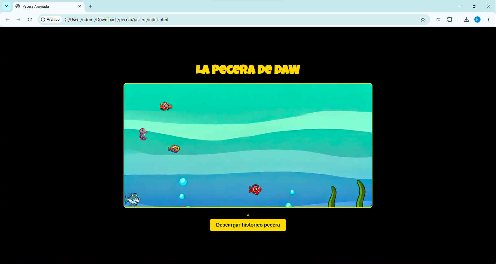

# La pecera de DAW

## Bienvenida/o

Durante este semestre crearemos una pecera para practicar lenguajes de script y animaciones en una página web con HTML y JavaScript.

## Estructura del proyecto

- `index.html`: página principal donde se muestra la pecera y se puede descargar el archivo de entrega.
- `comprueba.html`: página para comprobar el contenido de `pecera.pac`.
- `js/`
  - `pecera.js`: código JavaScript de la actividad. Aquí se crean los peces y se configuran sus movimientos.
  - `log.js`: archivo de soporte. **No modificar.**
  - `crypto-js.min.js`: biblioteca de soporte. **No modificar.**
- `img/`: imágenes de la pecera y de los peces.

## Resultado final

Así ha quedado la pecera:



## Actividad

Completa la pecera creando los siguientes peces. La clase `Pez` y los métodos de movimiento están proporcionados; no es necesario implementarlos. Utiliza el constructor con este orden de parámetros:

```js
new Pez(nombre, imagen, xInicial, yInicial, tipoMovimiento, log)
```

Por ejemplo:

```js
new Pez("Rubén", "img/pez1.png", 100, 100, "horizontal", log)
```

Peces que deben aparecer:

| Nombre | Imagen | Movimiento |
| --- | --- | --- |
| Rubén | `img/pez1.png` | `horizontal` |
| Laura | `img/pez2.png` | `zigzag` |
| Tamara | `img/pez3.png` | `burbujaCascada` |
| Tever | `img/pez4.png` | `horizontal` |
| Caballito | `img/caballito.png` | `zigzag` |

Puedes elegir las coordenadas iniciales de cada pez. Asegúrate de respetar exactamente los nombres de los movimientos.

## Generar y comprobar la entrega

1. Abre `index.html` en un navegador y comprueba que la pecera y los cinco peces se muestran y se mueven.
2. Pulsa **Descargar histórico pecera**. Se descargará el archivo `pecera.pac`; ese es el archivo que debes entregar.
3. Abre `comprueba.html`, selecciona el archivo `pecera.pac` y verifica que aparecen como correctos el nombre del alumno y los cinco peces con sus movimientos correspondientes.
